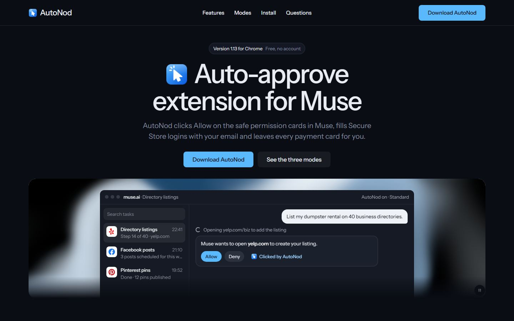

# AutoNod: Auto Approve Extension for Muse AI

**Muse, without the interruptions.** A free Chrome extension that auto-clicks **Allow** on safe Muse AI approval cards, fills **Secure Store** logins for you, and never touches payment cards.

**[⬇ Download AutoNod.zip (https://github.com/hassanasghardeveloper-svg/autonod-muse-ai-auto-approve/releases/latest/download/AutoNod.zip)](https://github.com/hassanasghardeveloper-svg/autonod-muse-ai-auto-approve/releases/latest/download/AutoNod.zip)** · Free · No account · No tracking

---

## Why AutoNod?

If you run long tasks in **Muse AI** (business directory listings, scheduled Facebook / Instagram / YouTube / Pinterest posts, research), Muse stops every few steps and asks *"Allow?"*. You sit and click **Allow** again and again.

**AutoNod clicks it for you**, safely:

- ✅ **Auto-approves safe cards.** Clicks *Allow* / *Always allow* on Muse permission cards.
- 🔑 **Fills Secure Store logins.** Clicks *Add*, puts **your email** in Username, generates a strong password and presses Enter.
- ✋ **Waits on money.** Payment, checkout and purchase cards are **never** clicked, in any mode.
- 🔴 **Red badge.** Cards that need you show a count on the AutoNod icon.
- 📋 **Dashboard.** Home, Activity, Waiting, Passwords and Settings in its own tab, with a full log of every card.
- 🌙 **Light and dark mode.**
- 🔒 **Private.** Everything stays in your Chrome. No servers, no analytics, no account.

## Three modes

| Mode | What gets auto-approved | What waits for you |
|---|---|---|
| **Safe** | Website cards only | Posts, messages, deletes, payments |
| **Standard** *(recommended)* | + post permissions (e.g. Facebook "create, edit, publish"), Secure Store logins | Single deletes, *Send* / *Post* buttons, payments |
| **Autopilot** | Everything + login forms | Payments (always) |

## Install in 2 minutes

1. **[Download AutoNod.zip](https://github.com/hassanasghardeveloper-svg/autonod-muse-ai-auto-approve/releases/latest/download/AutoNod.zip)** and unzip it (keep the folder).
2. Open `chrome://extensions` in Chrome.
3. Turn on **Developer mode** (top right).
4. Click **Load unpacked** and select the unzipped `AutoNod` folder (the one with `manifest.json`).
5. Pin AutoNod from the puzzle icon, pick a mode and enter your email.
6. Refresh **muse.ai** (F5). You'll see *"AutoNod is on"* bottom left.

> Works in Chrome, Edge, Brave, Opera and other Chromium browsers.

<b>Roman Urdu install guide</b>

1. Zip download karke unzip karein (folder delete na karein).
2. Chrome mein `chrome://extensions` kholein.
3. Upar right par **Developer mode** ON karein.
4. **Load unpacked** dabayein aur `AutoNod` folder chunein.
5. Puzzle icon se AutoNod pin karein, mode chunein, apni email likhein.
6. muse.ai ko F5 se refresh karein. Neeche left mein "AutoNod is on" aayega.

## FAQ

**Is AutoNod free?** Yes, completely free and open source (MIT).

**Is it safe?** Payment cards always wait for you. Only buttons that say *Allow*, *Approve* or *Always allow* are clicked. Action buttons like *Send* or *Post* wait in Safe and Standard mode. The code is right here, so you can read every line.

**Where are my passwords stored?** Only in your Chrome's local extension storage. They are never sent anywhere. Note: they are not encrypted, so anyone using your computer can see them in the dashboard.

**What permissions does it need?** Only `storage` and `scripting`, on `muse.ai` only.

**Does it solve CAPTCHAs?** No. CAPTCHAs are always yours.

**Is this made by Muse?** No. AutoNod is an unofficial, independent project, not affiliated with Muse.

**It says "Not running on this tab".** Click **Reconnect** in the popup, or refresh muse.ai.

## Privacy

AutoNod has no server and collects nothing. The only outside request is optional site icons from Google's favicon service (only the site name, e.g. `yelp.com`, is sent). Turn it off in *Settings > Show site icons*.

## Credits

- Card detection idea (Muse card marker, React approval id) from [Auto Approve for Muse](https://github.com/homieyangg/muse-auto-approve) by homieyangg (MIT).
- Font: [Instrument Sans](https://fonts.google.com/specimen/Instrument+Sans) (SIL Open Font License).

## Support

Found a bug or have an idea? [Open an issue](https://github.com/hassanasghardeveloper-svg/autonod-muse-ai-auto-approve/issues). If AutoNod saves you clicks, please **⭐ star this repo** so other Muse users can find it.

---

Keywords: Muse AI auto approve, Muse auto allow, Muse AI Chrome extension, auto click Allow, Muse Secure Store autofill, AI browser agent approvals, auto approve permission cards.
